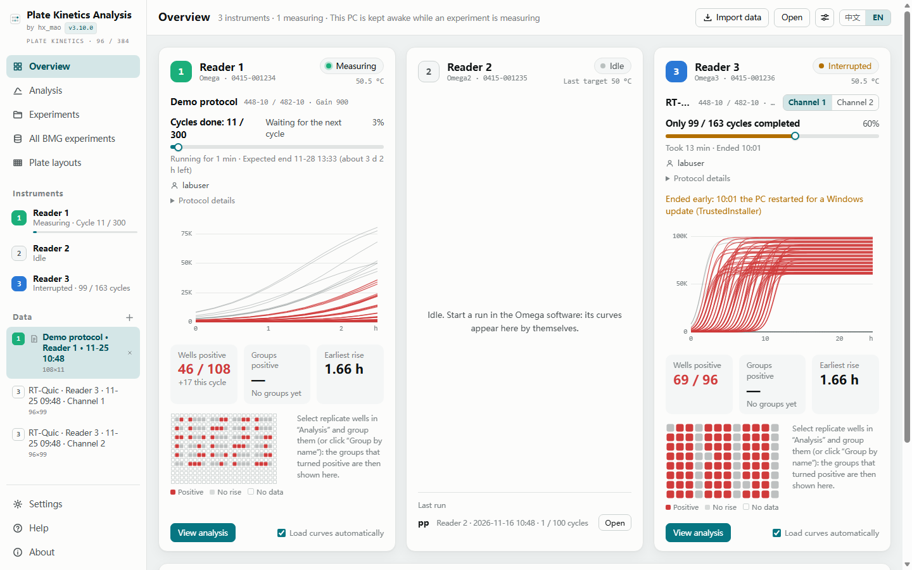
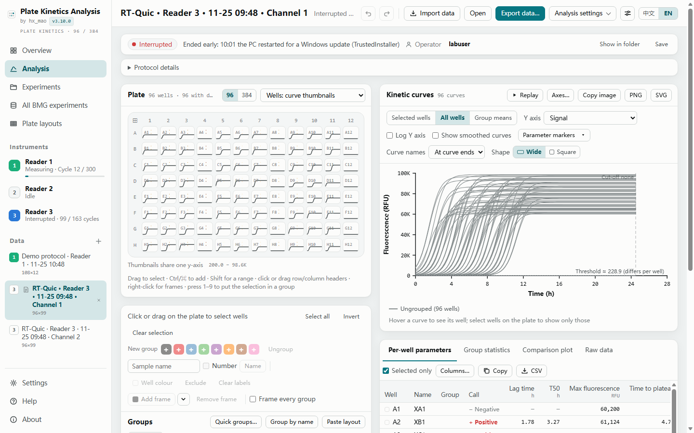
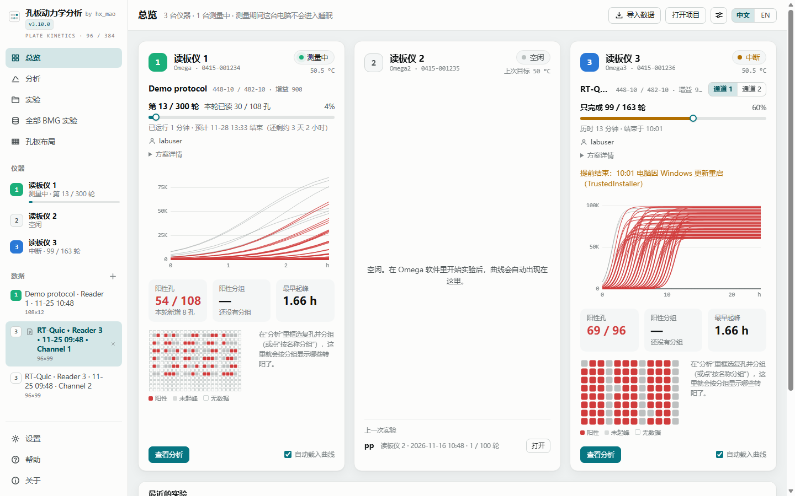

# Plate Kinetics Live (BMG Omega)

**English** · [中文](#中文说明)

Plate Kinetics Live is a Windows program for BMG LABTECH plate readers run by the Omega control software (verified:
FLUOstar Omega with Omega 6.20 and 6.40). While the reader measures, it **reads** (never writes or locks) the files the
Omega software writes, draws each well's kinetic curve live, and saves every run as a record (`.pk`) and an Excel
workbook. The analysis page is the same as the website [Plate Kinetics Analysis](https://tools.fow.mobi/kinetics/).





<sub>Screenshots with simulated data.</sub>

## Features

- **Live curves** for every reader on the PC (Omega, Omega2, ...), updated as each cycle is read; positive wells,
  earliest rise and progress at a glance.
- **Run records**: every run is saved as a `.pk` file and an Excel workbook in `PlateKineticsLive-data\Experiments\`,
  also when the PC restarted or the Omega software was closed during the run (gaps are filled from Omega's own files).
- **Analysis**: sample names, groups, thresholds, lag time / T50 / max fluorescence per well, group statistics, export.
- **Background service** (installed version): records from boot without a window or a login; tray notifications when a
  run finishes, stops early or is interrupted.
- **Safe for the instrument**: never controls the reader, never changes the Omega software's files.
- **No network use**: the web server listens on `127.0.0.1:47815` only; no usage statistics, no update checks.
- English and Chinese interface.

> For research use only, not for diagnostic use. Developed independently; not affiliated with or endorsed by
> BMG LABTECH. This repository contains no BMG program, library, manual or data file; it needs your own licensed
> installation of the Omega software. BMG LABTECH, Omega, FLUOstar and MARS are trademarks of BMG LABTECH GmbH, used
> here only to say whose software's files the program reads. See [help/NOTICE.txt](help/NOTICE.txt).

## Download

Ready-made builds are on the [Releases](https://github.com/hengxu2010/plate-kinetics-live/releases) page:

| File | Use |
|---|---|
| `PlateKineticsLive-Setup.exe` | Installer (run as administrator). Installs to `C:\Program Files\Plate Kinetics Live (BMG)` with the background service |
| `PlateKineticsLive-portable.zip` | Portable: unzip, run `PlateKineticsLive.exe`; records while its window is open |

Requires Windows 10/11 (the .NET Framework 4.8 and the WebView2 Runtime are part of Windows).

## Use

Install it on the PC with the Omega software and open it. When a measurement starts, the program finds the run and
shows its curves. Use `--bmg-root <folder>` when the Omega software is not in its default location. The full manual
is [help/index.html](help/index.html) (also under *Help* in the program).

## Build

Needs Windows 10/11 and the [.NET SDK](https://dotnet.microsoft.com/download) (6 or later, for building only).
Nothing is downloaded: the WebView2 DLLs are in `vendor\webview2\` (signed by Microsoft, version 1.0.4370.26).

```powershell
powershell -ExecutionPolicy Bypass -File build.ps1
```

Output in `dist\`: `PlateKineticsLive-Setup.exe` and `PlateKineticsLive-portable.zip`. Options: `-Version <a.b.c.d>`;
`-Offline` also makes an offline package (put Microsoft's .NET 4.8 and WebView2 offline installers in `redist\` first).

| Folder | Contents |
|---|---|
| `src\Bmg\` | Reading Omega's data files and databases, building the run records |
| `src\Common\` | Window (WebView2), local web server, service, tray, data folder, `.pk` and Excel files |
| `src\Setup\` | The installer (install, update, move, uninstall) |
| `web\` | The interface: the analysis page `PlateKineticsAnalysis.html` and its shell (`shell.js`, `shell.css`, `live.js`) |
| `help\` | Manual and licence texts (installed as `Help\`) |
| `vendor\webview2\` | Microsoft WebView2 SDK DLLs and their licence |
| `tools\make-icon.ps1` | Draws the program icon `src\app.ico` |

## License

MIT, see [LICENSE](LICENSE). Third-party components (Microsoft WebView2 SDK, SheetJS) keep their own licences, see
[help/THIRD-PARTY-NOTICES.txt](help/THIRD-PARTY-NOTICES.txt).

---

## 中文说明

Plate Kinetics Live 是 Windows 程序，给用 Omega 控制软件的 BMG LABTECH 读板仪用（已验证 FLUOstar Omega，Omega 6.20 和 6.40）。
测量时它**只读** Omega 写下的数据文件，实时画出每个孔的动力学曲线，并把每次实验自动存成 `.pk` 记录和 Excel 表。
界面有中文和英文。



<sub>截图为模拟数据。</sub>

- **下载**：在 [Releases](https://github.com/hengxu2010/plate-kinetics-live/releases) 页面。`PlateKineticsLive-Setup.exe`
  是安装版（管理员权限，带开机自动记录的后台服务）；`PlateKineticsLive-portable.zip` 是便携版（解压运行，窗口开着时记录）。
- **使用**：装在有 Omega 软件的电脑上，开始测量后程序自动找到实验并显示曲线。Omega 不在默认位置时用 `--bmg-root <文件夹>`。
  详细说明见程序里的"帮助"或 [help/index.html](help/index.html)。
- **编译**：装好 .NET SDK 后运行 `powershell -ExecutionPolicy Bypass -File build.ps1`，成品在 `dist\`。不需要联网下载任何包。
- **安全**：不控制仪器，不改 Omega 的文件；不联网，网页服务只开在本机 `127.0.0.1:47815`。

> 仅供科研使用，不用于临床诊断。本项目独立开发，与 BMG LABTECH 无关，也没有得到它的认可。本仓库不含 BMG 的任何程序、
> 库文件、说明书或数据文件，使用时需要你自己合法安装的 Omega 软件。BMG LABTECH、Omega、FLUOstar、MARS 是 BMG LABTECH GmbH
> 的商标，这里只用来说明本程序读取哪个软件的文件。许可证：MIT。
